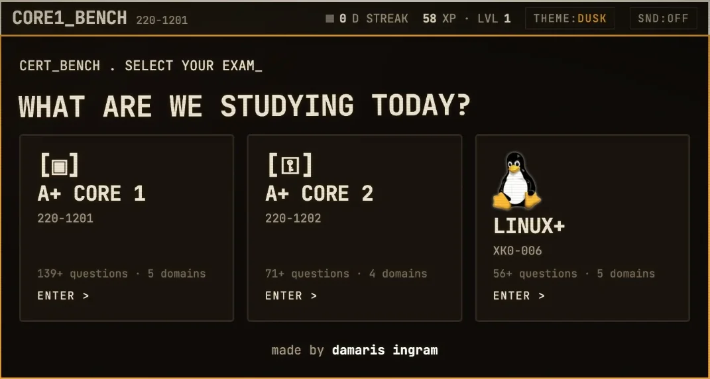
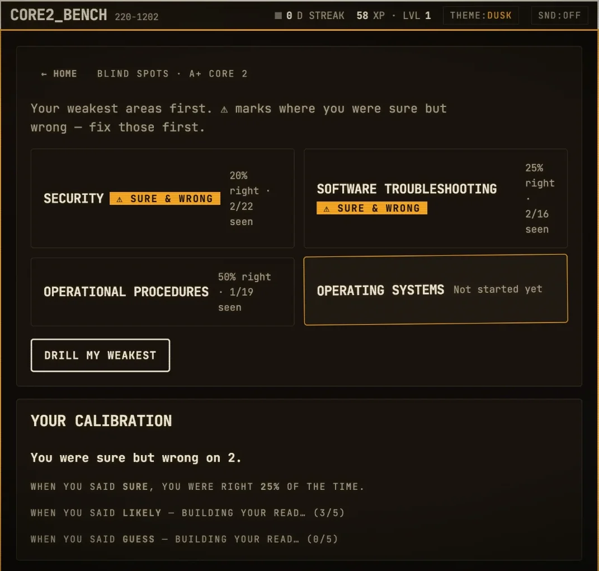
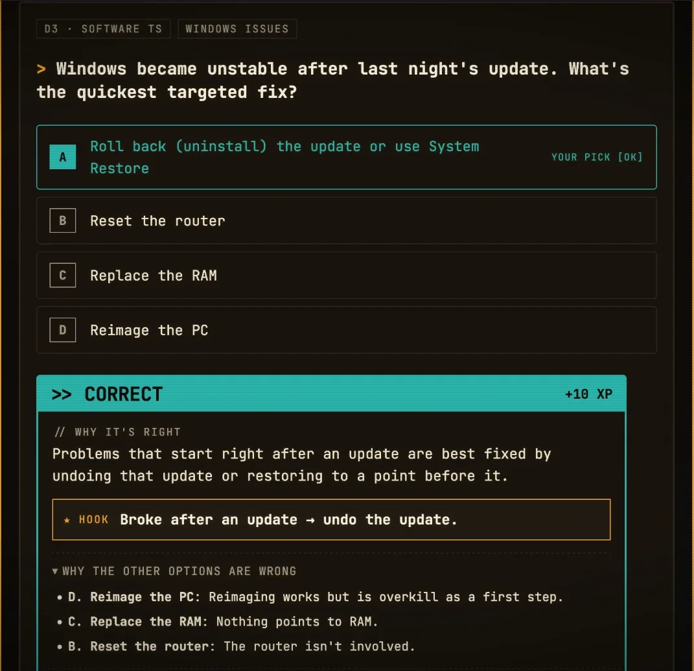

I built this because long practice tests were a slow way to learn. It gives quick questions with instant feedback instead, and it keeps bringing back what I get wrong until it sticks. It covers CompTIA A+ Core 1 (220-1201), A+ Core 2 (220-1202) and Linux+ (XK0-006).

[Open the app ↗](https://damyris.github.io/networking-study-tool/) · [Source code ↗](https://github.com/damyris/networking-study-tool)

## What it does

- **10-question sprints** weighted like the real exam domains
- **Instant feedback** on why each wrong answer doesn't fit
- **A one-line memory "hook"** for every question
- **Spaced repetition:** missed questions come back until they stick
- **60-second Lightning rounds** for ports, commands and specs
- **Blind Spots:** your weakest domains first
- **Confidence calibration:** flags answers you were sure about but got wrong
- **XP, streaks and levels**, in a retro CRT design with sound

Built with HTML, CSS and JavaScript, hosted on GitHub Pages.

## Screenshots

Independent study tool. Not affiliated with or endorsed by CompTIA.
